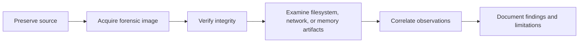

# Digital Forensics Portfolio

This repository presents selected methods and learning from completed TSIT14 digital forensics coursework. It is a sanitized portfolio summary, not a copy of the submitted reports.

## Topics

- Evidence acquisition and integrity verification
- GPT partition and filesystem examination
- ext4 inode interpretation and deleted-file analysis
- Network traffic reconstruction with Wireshark and `tshark`
- Windows memory analysis with Volatility

## Repository map

| Folder | Contents |
| --- | --- |
| [`01-evidence-acquisition/`](01-evidence-acquisition/README.md) | Forensic imaging and integrity checks |
| [`02-filesystem-forensics/`](02-filesystem-forensics/README.md) | Partition, ext4, and NTFS analysis |
| [`03-network-forensics/`](03-network-forensics/README.md) | PCAP examination and incident reconstruction |
| [`04-memory-forensics/`](04-memory-forensics/README.md) | Windows memory, process, registry, and event analysis |
| [`references/`](references/tools-and-resources.md) | Tools and public documentation |

## Investigation workflow

## Data handling

- Source reports, forensic images, memory dumps, packet captures, recovered files, and course datasets are not included.
- Credentials, hashes, personal details, host identifiers, and case-specific network indicators are omitted.
- A separate investigation report is marked **Confidential** and is not reproduced or summarized here.
- Any future screenshot must be reviewed and redacted before it is added. No screenshot is included unless its contents and sharing rights have been checked.

## Verification note

The lab report describes three orphan entries from an ext4 deleted-entry listing. The command run by the author produced no output. This mismatch has not been resolved, so the entry count is not presented as a verified result in this portfolio. See [deleted-file analysis](02-filesystem-forensics/deleted-file-analysis.md).

## Scope and limitations

These pages summarize coursework that was already completed. They do not claim that the excluded evidence can be reproduced from this repository. Results are limited to the source material and checks described in the reports.
